# InboxBrief

[](https://github.com/lesonthehub/inboxbrief/actions/workflows/ci.yml)

[InboxBrief](https://inboxbrief.org) is a full-stack SaaS application that turns unread Gmail and Outlook messages into concise, actionable SMS briefings. It combines provider OAuth, an AI summarization pipeline, subscription controls, and operational dashboards in a type-safe TypeScript codebase.

> **Portfolio note:** This repository is shared to demonstrate product engineering and system design. It contains no production credentials, customer data, or database exports. External services require independently configured accounts and environment variables.

## Screenshots

Public screens are captured from the development preview. Admin, customer, owner, billing, and account-security screens show the existing React interface rendered in an isolated local browser with **fictional demo data and mocked API responses**. Names, account states, revenue figures, and audit events are illustrative—not production records or proof of live payment processing. No real customer data, permissions, payments, invoices, or authentication secrets were accessed or changed. The sample SMS briefing is also illustrative.

### Website

The landing page introduces the inbox-to-SMS service and trial signup.

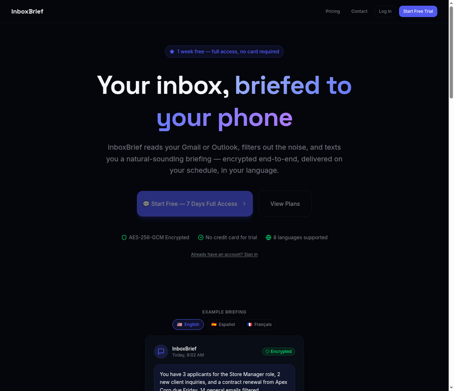

### SMS briefing and email-processing workflow

The multilingual sample briefing and the connect, classify, and deliver workflow.

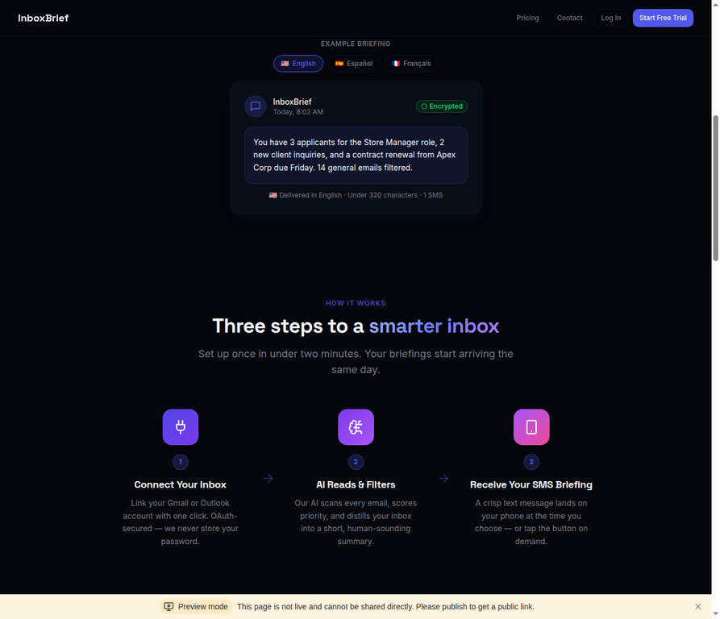

### Personalized onboarding

The first step of the five-step onboarding flow collects business context for briefing preferences.

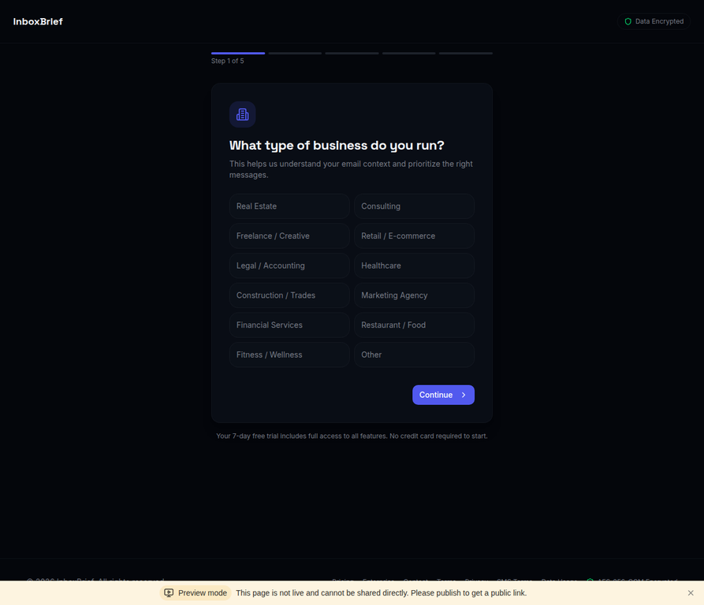

### Subscription plans

The pricing interface compares Solo, Pro, and Business features and usage limits.

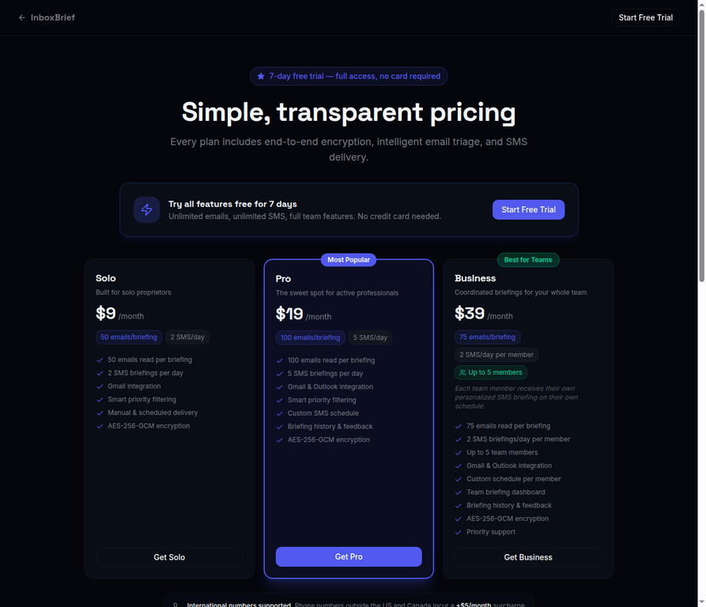

### Admin dashboard — demo data

Operational statistics, subscription counts, onboarding analytics, and coupon-management controls. Financial figures shown here are fictional fixtures.

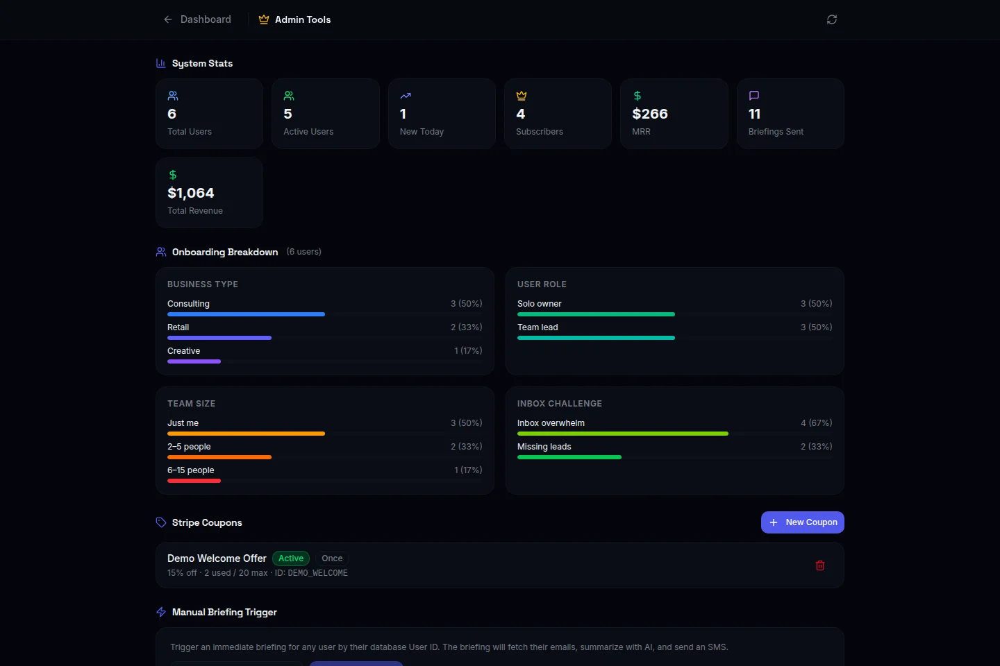

### Customer management — demo data

Searchable customer records, paid-versus-trial plan badges, trial days remaining, account age, and separate suspended/deleted states.

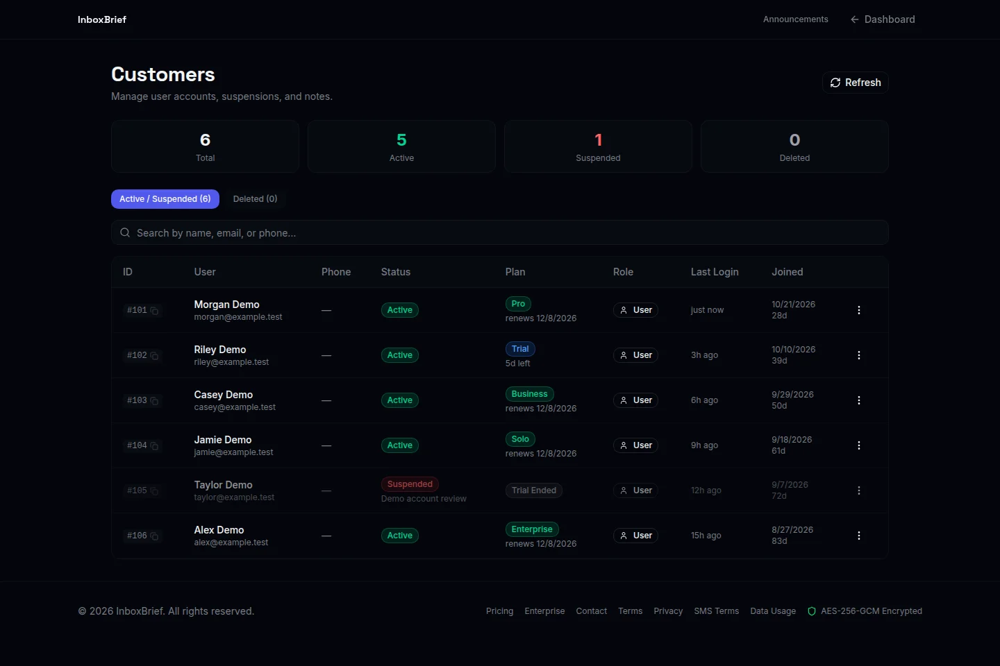

### Owner dashboard — demo data

Owner-only administration, service-grant and enterprise navigation, and a searchable activity log with actor, target, and TOTP-verification columns. The displayed events are fixtures, not actions performed during capture.

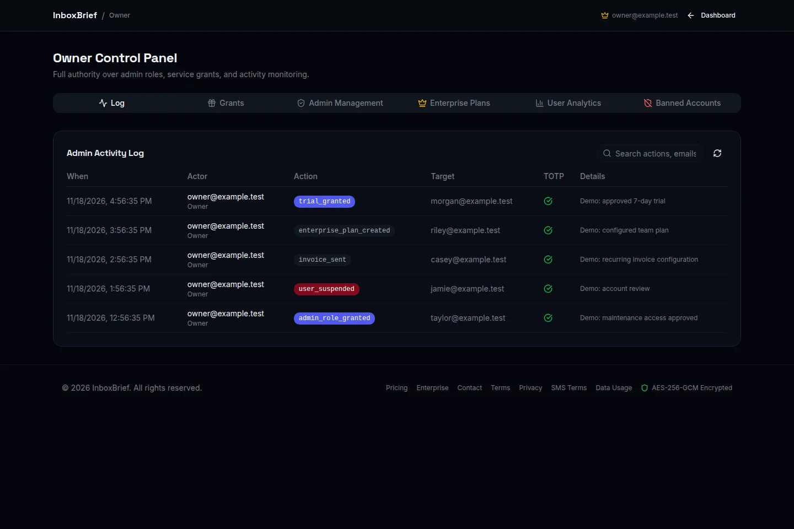

### Enterprise billing — demo data

The invoice dialog supports one-time or recurring billing, a due-date interval, an optional subscription end date, notes, and a required TOTP code. This screenshot shows configuration controls only; no invoice was sent.

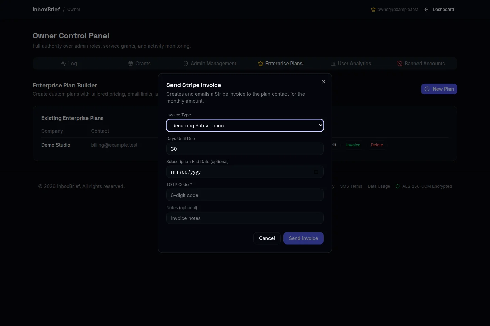

<details>
<summary>View enterprise plan-management controls</summary>

Custom plan pricing, team seats, assignment, editing, invoicing, and deletion controls for a fictional company.

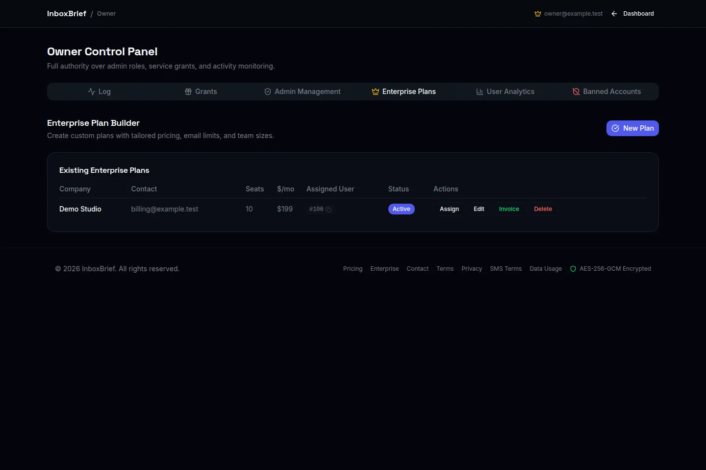

</details>

### Authentication and authorization

The login interface offers Google and Microsoft OAuth. The implementation is in [`server/socialLogin.ts`](server/socialLogin.ts); API session context and procedure guards are in [`server/_core/context.ts`](server/_core/context.ts) and [`server/_core/trpc.ts`](server/_core/trpc.ts). The screenshot shows provider selection, not a completed OAuth or verification flow.

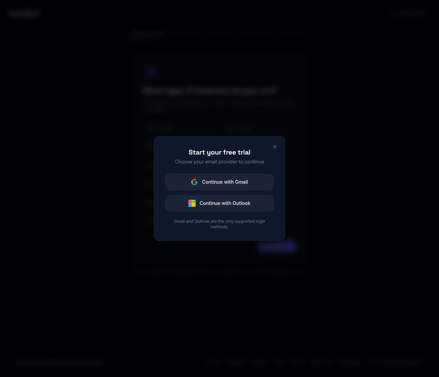

<details>
<summary>View TOTP-protected admin actions and account security — demo data</summary>

Sensitive administrative actions collect an authenticator code; the example below opens the trial-grant dialog without submitting it. Role and TOTP checks are implemented server-side in [`server/routers.ts`](server/routers.ts), not only in the UI.

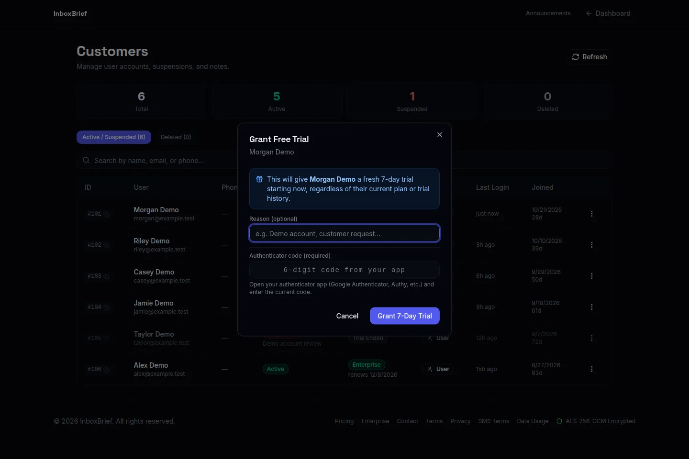

Account settings expose billing management, authenticator status, and account-deletion controls. The enabled authenticator and active subscription shown below are mocked states; no TOTP seed or real account is displayed.

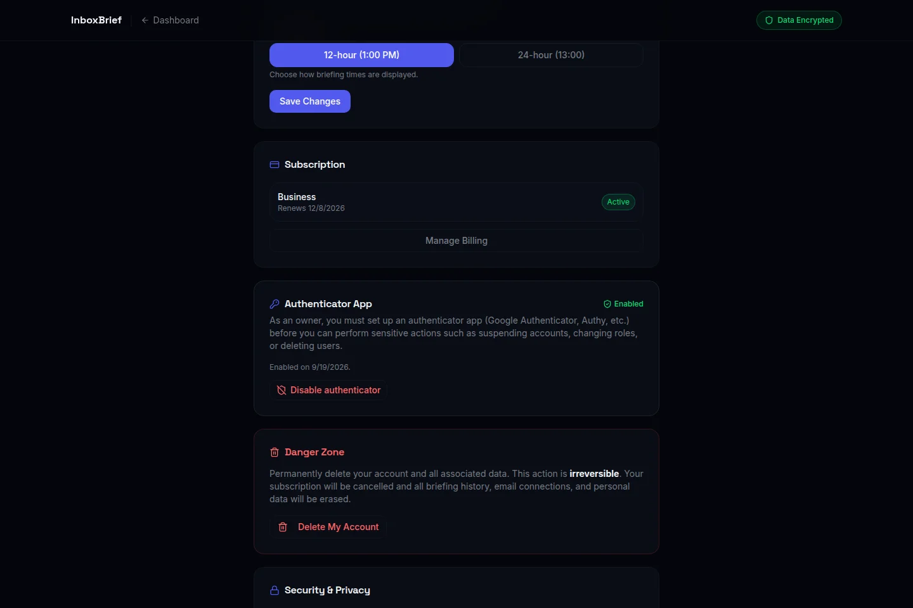

</details>

## What it does

1. A user connects a Gmail or Outlook inbox through OAuth.
2. The backend retrieves eligible unread messages, normalizes their metadata and snippets, and classifies them by priority.
3. An AI provider generates a concise briefing based on the selected tone and keyword preferences.
4. InboxBrief encrypts the stored summary and sends the briefing through Twilio SMS.
5. Users can trigger a briefing manually or use a scheduled delivery cadence; Stripe-backed plan rules and usage limits are enforced before delivery.

The application also includes trial onboarding, phone verification, team seats and invites, customer feedback preferences, Stripe billing, enterprise-plan administration, role-based admin tools, audit logs, and account lifecycle controls.

## Architecture at a glance

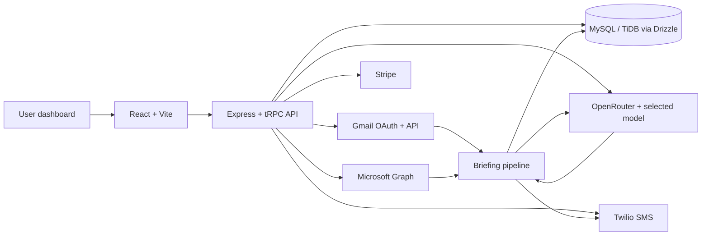

See [the architecture reference](docs/ARCHITECTURE.md) for component boundaries, data flow, and design decisions.

## Technology

| Area | Tools |
| --- | --- |
| Client | React 19, Vite, TypeScript, Tailwind CSS, Wouter |
| API | Express 4, tRPC 11, Zod |
| Persistence | Drizzle ORM with MySQL/TiDB |
| Email providers | Gmail API, Microsoft Graph |
| AI summarization | OpenRouter with a selected model provider |
| Messaging | Twilio Programmable Messaging |
| Billing | Stripe Checkout, Billing Portal, webhooks |
| Tests | Vitest |
| Deployment/runtime | Node.js 22+, pnpm |

## Local development

### Prerequisites

- Node.js 22 or later
- pnpm 10
- A MySQL-compatible database
- Accounts/configuration for the integrations you intend to exercise: Google, Microsoft, OpenRouter, Twilio, Stripe, SMTP, and the account-auth provider

### Install and configure

```bash
git clone https://github.com/lesonthehub/inboxbrief.git
cd inboxbrief
pnpm install --frozen-lockfile
```

Create an untracked `.env` file with development-only values using the [configuration reference](docs/CONFIGURATION.md). Do not commit `.env` files or real API keys. For the database schema, run:

```bash
pnpm db:push
```

Then start the development server:

```bash
pnpm dev
```

The server uses port `3000` by default and will select the next available port if it is occupied.

### Useful commands

| Command | Purpose |
| --- | --- |
| `pnpm dev` | Start the Express/Vite development server |
| `pnpm build` | Build client assets and bundle the server |
| `pnpm start` | Run the production bundle |
| `pnpm check` | Run TypeScript without emitting files |
| `pnpm test` | Run the Vitest suite |
| `pnpm db:push` | Generate and apply Drizzle migrations |
| `pnpm format` | Format files with Prettier |

## Security and privacy design

InboxBrief uses several defense-in-depth controls:

- OAuth access and refresh tokens, plus persisted briefing summaries, are encrypted with AES-256-GCM before storage.
- Fetched email text is processed in memory for the briefing flow rather than stored as raw email content in the briefing log.
- Gmail access is limited to `gmail.readonly`; Outlook uses read-only mail access. The exact provider scopes are documented in [the architecture reference](docs/ARCHITECTURE.md#provider-boundaries).
- API middleware applies security headers, request-size limits, origin validation, input sanitization, rate limits, and no-store response headers for API routes.
- Sensitive administration and lifecycle actions are written to an audit log, with known secret fields redacted.

This is not an end-to-end-encrypted messaging system: email-derived content is sent to the configured AI provider to generate the requested briefing, and the final briefing is delivered by the configured SMS provider. Review the deployed privacy policy and provider agreements before operating a production instance.

## Current scope and limitations

This repository reflects the implemented project rather than a general-purpose email client:

- Email processing targets unread Gmail messages (excluding social, promotions, spam, and trash) and unread Outlook inbox messages, with a maximum fetch batch of 100 messages.
- Briefings use email metadata and preview/snippet content, not an arbitrary full-mail archive.
- Scheduled custom delivery is currently evaluated at an hour boundary; custom schedule entries should be treated as hour-level until minute-level scheduling is expanded.
- Gmail restricted-scope verification and the configuration of all third-party services remain deployment responsibilities.

## Repository layout

```text
client/        React interface, routes, and reusable UI components
server/        Express/tRPC API, email adapters, briefing pipeline, billing, security
drizzle/       Database schema and generated migrations
shared/        Shared constants and error types
docs/          Architecture and development documentation
scripts/       Operational development and migration utilities
```

## Verification

The repository includes a GitHub Actions workflow that runs type checking and Vitest on pushes and pull requests. Before opening a pull request or sharing a branch, run:

```bash
pnpm check
pnpm test
```

## License

This project is released under the [MIT License](LICENSE) as declared in `package.json`.
