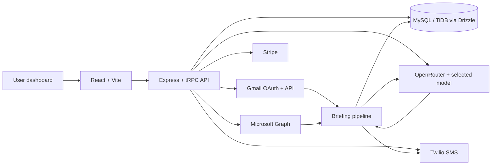

# InboxBrief

[InboxBrief](https://inboxbrief.org) is a full-stack SaaS application that turns unread Gmail and Outlook messages into concise, actionable SMS briefings. It combines provider OAuth, an AI summarization pipeline, subscription controls, and operational dashboards in a type-safe TypeScript codebase.

> **Portfolio note:** This repository is shared to demonstrate product engineering and system design. It contains no production credentials, customer data, or database exports. External services require independently configured accounts and environment variables.

## What it does

1. A user connects a Gmail or Outlook inbox through OAuth.
2. The backend retrieves eligible unread messages, normalizes their metadata and snippets, and classifies them by priority.
3. An AI provider generates a concise briefing based on the selected tone and keyword preferences.
4. InboxBrief encrypts the stored summary and sends the briefing through Twilio SMS.
5. Users can trigger a briefing manually or use a scheduled delivery cadence; Stripe-backed plan rules and usage limits are enforced before delivery.

The application also includes trial onboarding, phone verification, team seats and invites, customer feedback preferences, Stripe billing, enterprise-plan administration, role-based admin tools, audit logs, and account lifecycle controls.

## Architecture at a glance



See [the architecture reference](docs/ARCHITECTURE.md) for component boundaries, data flow, and design decisions.

## Technology

| Area | Tools |
| --- | --- |
| Client | React 19, Vite, TypeScript, Tailwind CSS, Wouter |
| API | Express 4, tRPC 11, Zod |
| Persistence | Drizzle ORM with MySQL/TiDB |
| Email providers | Gmail API, Microsoft Graph |
| AI summarization | OpenRouter with a selected model provider |
| Messaging | Twilio Programmable Messaging |
| Billing | Stripe Checkout, Billing Portal, webhooks |
| Tests | Vitest |
| Deployment/runtime | Node.js 22+, pnpm |

## Local development

### Prerequisites

- Node.js 22 or later
- pnpm 10
- A MySQL-compatible database
- Accounts/configuration for the integrations you intend to exercise: Google, Microsoft, OpenRouter, Twilio, Stripe, SMTP, and the account-auth provider

### Install and configure

```bash
git clone https://github.com/lesonthehub/inboxbrief.git
cd inboxbrief
pnpm install --frozen-lockfile
```

Create an untracked `.env` file with development-only values using the [configuration reference](docs/CONFIGURATION.md). Do not commit `.env` files or real API keys. For the database schema, run:

```bash
pnpm db:push
```

Then start the development server:

```bash
pnpm dev
```

The server uses port `3000` by default and will select the next available port if it is occupied.

### Useful commands

| Command | Purpose |
| --- | --- |
| `pnpm dev` | Start the Express/Vite development server |
| `pnpm build` | Build client assets and bundle the server |
| `pnpm start` | Run the production bundle |
| `pnpm check` | Run TypeScript without emitting files |
| `pnpm test` | Run the Vitest suite |
| `pnpm db:push` | Generate and apply Drizzle migrations |
| `pnpm format` | Format files with Prettier |

## Security and privacy design

InboxBrief uses several defense-in-depth controls:

- OAuth access and refresh tokens, plus persisted briefing summaries, are encrypted with AES-256-GCM before storage.
- Fetched email text is processed in memory for the briefing flow rather than stored as raw email content in the briefing log.
- Gmail access is limited to `gmail.readonly`; Outlook uses read-only mail access. The exact provider scopes are documented in [the architecture reference](docs/ARCHITECTURE.md#provider-boundaries).
- API middleware applies security headers, request-size limits, origin validation, input sanitization, rate limits, and no-store response headers for API routes.
- Sensitive administration and lifecycle actions are written to an audit log, with known secret fields redacted.

This is not an end-to-end-encrypted messaging system: email-derived content is sent to the configured AI provider to generate the requested briefing, and the final briefing is delivered by the configured SMS provider. Review the deployed privacy policy and provider agreements before operating a production instance.

## Current scope and limitations

This repository reflects the implemented project rather than a general-purpose email client:

- Email processing targets unread Gmail messages (excluding social, promotions, spam, and trash) and unread Outlook inbox messages, with a maximum fetch batch of 100 messages.
- Briefings use email metadata and preview/snippet content, not an arbitrary full-mail archive.
- Scheduled custom delivery is currently evaluated at an hour boundary; custom schedule entries should be treated as hour-level until minute-level scheduling is expanded.
- Gmail restricted-scope verification and the configuration of all third-party services remain deployment responsibilities.

## Repository layout

```text
client/        React interface, routes, and reusable UI components
server/        Express/tRPC API, email adapters, briefing pipeline, billing, security
drizzle/       Database schema and generated migrations
shared/        Shared constants and error types
docs/          Architecture and development documentation
scripts/       Operational development and migration utilities
```

## Verification

The repository includes a GitHub Actions workflow that runs type checking and Vitest on pushes and pull requests. Before opening a pull request or sharing a branch, run:

```bash
pnpm check
pnpm test
```

## License

This project is released under the [MIT License](LICENSE) as declared in `package.json`.
