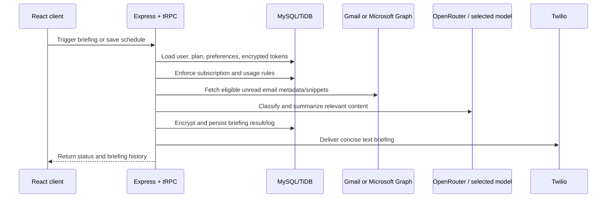

# Architecture reference

InboxBrief is organized as a TypeScript monorepo-style web application. The React client communicates with an Express server through tRPC; the server owns all third-party credentials, database operations, AI requests, billing webhooks, and SMS delivery.

## System boundaries

## Client

The client lives in `client/src` and uses React 19, Wouter, Tailwind, and tRPC React Query hooks. `client/src/App.tsx` defines public, account, admin, and owner routes. The dashboard is the primary user interface for provider connections, delivery settings, briefing history, feedback, team seats, and subscription status.

## API and domain logic

`server/routers.ts` is the tRPC composition root. It contains authenticated procedures for onboarding, account configuration, provider connections, manual briefing triggers, billing, customer administration, and role-gated owner tools. The backend is initialized in `server/_core/index.ts`, which applies security middleware, mounts webhooks and OAuth callbacks, starts the scheduler, and serves Vite in development or static assets in production.

The key domain boundary is `server/briefingPipeline.ts`. It coordinates the deliberate sequence below:

1. Load the user, phone verification state, subscription, trial, service-grant, and test-account gates.
2. Decrypt the account-scoped OAuth credentials in memory.
3. Fetch eligible messages from each connected account.
4. Classify fetched messages as high priority, general, or ignorable.
5. Generate an SMS-length briefing based on user preferences.
6. Encrypt the persisted summary and write a briefing log.
7. Send the delivery through the SMS adapter and persist its status.

This separation makes the fetch/classify/summarize/deliver flow independently understandable from the route layer.

## Provider boundaries

### Gmail

`server/emailProviders.ts` builds the Gmail authorization flow using exactly these scopes:

- `https://www.googleapis.com/auth/gmail.readonly`
- `https://www.googleapis.com/auth/userinfo.email`

The Gmail reader queries eligible unread mail, excluding promotions, social, spam, and trash. It requests message metadata plus snippets and caps provider fetches at 100 messages. It does not request compose, send, modify, or delete access.

### Outlook

The Microsoft authorization flow requests `offline_access`, `Mail.Read`, and `User.Read`. The adapter uses Microsoft Graph and records a delta/next-link cursor for incremental delivery cycles.

### AI and SMS

The classification and summarization code uses OpenRouter and the configured model provider. Twilio delivers the generated text briefing. These are service-provider boundaries: email-derived data necessary to create the requested summary is sent to the configured AI provider, and the final summary is sent to the configured SMS provider.

### Billing

Stripe Checkout, the customer portal, invoices, refunds, and webhook reconciliation are handled on the server. Stripe webhook registration occurs before the JSON parser so signature verification can operate on the raw request body.

## Persistence

Drizzle defines the application schema in `drizzle/schema.ts`. The primary tables are:

| Table area | Responsibility |
| --- | --- |
| `users` | Identity, onboarding, delivery preferences, roles, trial state, lifecycle flags |
| `email_accounts` | Connected provider metadata and encrypted OAuth credentials |
| `briefing_logs` | Encrypted generated summaries, fetch counts, delivery status, and errors |
| `subscriptions` | Stripe identifiers, plans, seats, lifecycle status, renewal state |
| `audit_logs` | Sensitive-action history with sensitive fields redacted before storage |
| `team_members` | Seat-limited team invitations and membership state |

## Security controls

The application uses AES-256-GCM in `server/encryption.ts` to protect persisted OAuth credentials and briefing summaries. `server/security.ts` centralizes HTTP security headers, origin validation, body-size limits, input sanitization, rate limiting, API no-store headers, and audit-log redaction.

The system should be described as having encryption at rest for the data it persists; it is not end-to-end encrypted because the backend must access provider credentials and process information through configured AI and SMS services.

## Scheduling and background work

`server/webhookAndScheduler.ts` starts an in-process scheduler that evaluates delivery schedules once per minute. It triggers daily morning, daily evening, twice-daily, and custom schedules, then delegates each eligible user to the pipeline. Custom scheduling is currently evaluated on the configured hour boundary.

For a horizontally scaled deployment, the scheduler should be replaced or protected by a distributed job lock/queue so multiple application instances cannot trigger the same delivery.

## Testing boundary

Vitest tests are colocated with server logic in `server/**/*.test.ts`. The suite focuses on business rules and integration configuration such as price mapping, briefing policy, OAuth/pipeline behavior, and onboarding validation. `pnpm check` verifies TypeScript across the application; `pnpm test` runs the test suite.
